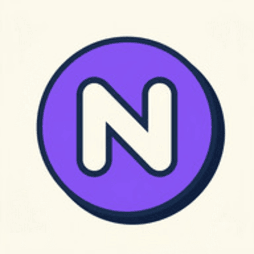
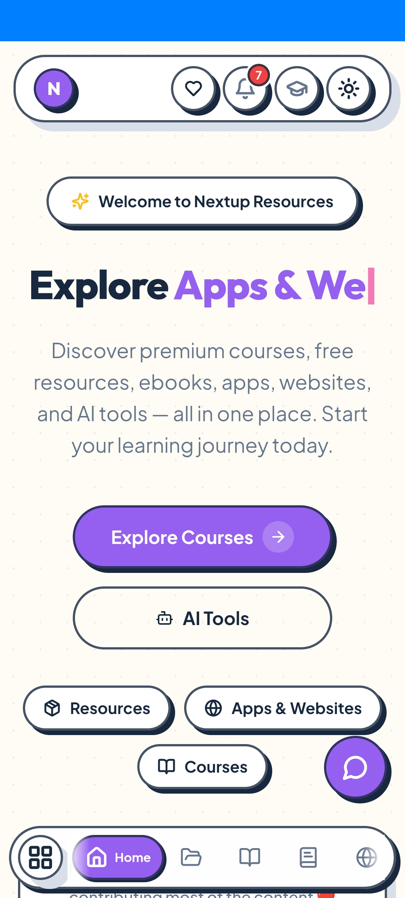
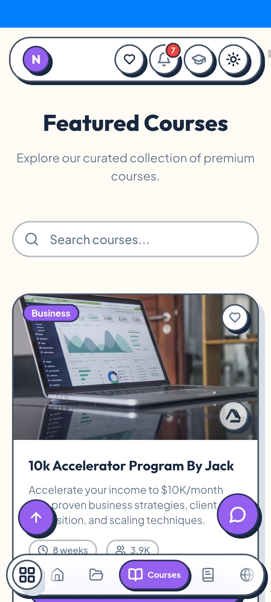
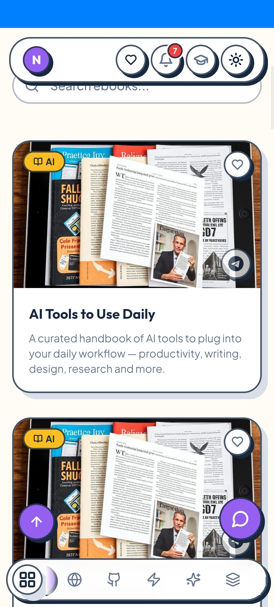
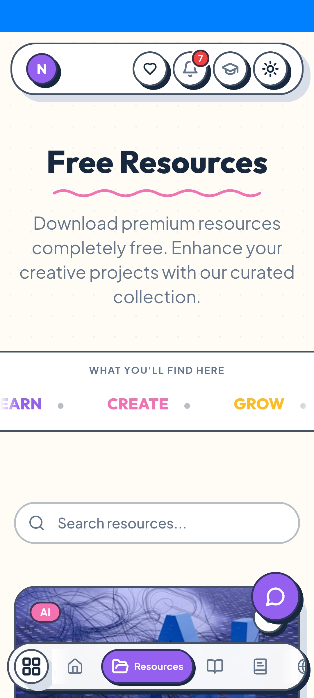
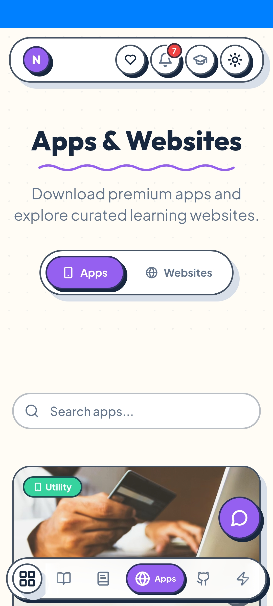

<p align="center">
  
</p>

<h1 align="center">Nextup Resources</h1>

<p align="center">
  <b>The modern hub for premium learning, free developer utilities, curated FOSS, ebooks, and AI workflows.</b>
</p>

<p align="center">
  <a href="https://nextup-resource.vercel.app"></a>
  <a href="https://github.com/shreyagarwal72/nextup-resource/releases/latest"></a>
  <a href="https://github.com/shreyagarwal72/nextup-resource/stargazers"></a>
  <a href="https://www.youtube.com/@nextupstudioyt"></a>
  <a href="https://www.instagram.com/hereyourchampion/"></a>
</p>

<p align="center">
  
  
  
  
  
  
  
</p>

---

## 🧭 Overview

**Nextup Resources** is a curated, high-performance web platform and progressive web application built for engineers, creators, and students. It brings together vetted online courses, AI prompts and tools, digital libraries, and open-source applications into a responsive, mobile-first interface with multi-engine theme customization.

---

## 🎨 Interactive Design Systems

Experience the site through 4 distinct visual languages with dedicated animations, sound/haptic cues, and custom geometries:

| Theme | Aesthetic & Highlights | Signature Elements |
| :--- | :--- | :--- |
| **Playful Geometric** | Bold neobrutalist sticker cards, high contrast, vibrant primary pops | Hard drop shadows, bounce springs, snappy micro-interactions |
| **Claymorphism** | Tactile 3D inflated pill controls and soft ambient lighting | Dual inner & outer shadows, organic floating ambient blobs |
| **Squid Game ○△□** | High-tension dystopian cyber aesthetic, CRT scanlines | Guard Pink (`#FF007A`), Tracksuit Teal, Red Light/Green Light toggles |
| **Minecraft ⛏** | Authentic retro voxel GUI panels & HUD styling | 3D beveled stone buttons, XP green accents, VT323 typography |

---

## ✨ Core Features

<table>
  <tr>
    <td width="50%">
      <h3>🎓 Catalogs & Libraries</h3>
      <ul>
        <li><b>50+ Premium Courses:</b> Web dev, mobile dev, AI & DevOps.</li>
        <li><b>Curated Ebooks & Docs:</b> Searchable technical reference library.</li>
        <li><b>AI Tools Directory:</b> Prompts, LLMs, and generation models.</li>
        <li><b>FOSS & Modern Apps:</b> Shizuku, Morphe, and Material You tools.</li>
      </ul>
    </td>
    <td width="50%">
      <h3>⚡ Experience & Performance</h3>
      <ul>
        <li><b>Smart Offline PWA:</b> Stale-while-revalidate client caching.</li>
        <li><b>Global Instant Search:</b> Fuzzy match across all items in milliseconds.</li>
        <li><b>Study Mode:</b> Minimalist, distraction-free focus workspace.</li>
        <li><b>Haptic Engine:</b> Tactile vibrations on interactive button taps.</li>
      </ul>
    </td>
  </tr>
</table>

---

## 📸 Screenshots

<p align="center">
  
  
  
  
  
</p>

---

## 🛠 Tech Architecture

```
nextup-resource/
├── public/                 # Static assets, textures, and manifest
│   ├── minecraft/          # Pixel art textures (dirt, xp, diamond, etc.)
│   └── icons/              # App launcher & PWA icons
├── src/
│   ├── components/         # Reusable widgets (Header, Hotbar, Themes)
│   │   ├── ui/             # Radix UI + shadcn primitives
│   │   ├── SquidBackground.tsx
│   │   └── MinecraftBackground.tsx
│   ├── pages/              # Routed pages (Home, Catalogs, Settings, Admin)
│   ├── lib/                # Database bridge, cache sync, and utilities
│   └── index.css           # Global tokens & theme keyframe animations
```

- **Frontend Core:** [React 18](https://react.dev/) + [TypeScript 5](https://www.typescriptlang.org/)
- **Bundler & Build Tool:** [Vite](https://vitejs.dev/)
- **Styling Engine:** [Tailwind CSS](https://tailwindcss.com/) + CSS variables
- **Motion & Transitions:** [Framer Motion](https://www.framer.com/motion/) + CSS keyframes
- **State & Data Sync:** [TanStack Query](https://tanstack.com/query/latest) + LocalStorage bridge
- **Backend Infrastructure:** [Supabase](https://supabase.com/)

---

## 🚀 Getting Started

### Prerequisites
- Node.js (v18+)
- npm, pnpm, or bun

### Local Installation

```bash
# 1. Clone the repository
git clone https://github.com/shreyagarwal72/nextup-resource.git

# 2. Enter the project directory
cd nextup-resource

# 3. Install dependencies
npm install

# 4. Start the development server
npm run dev
```

### Production Build

```bash
npm run build
npm run preview
```

---

## ⚙️ Backend-Driven Synchronization

Every catalog lives in the backend `site_content` table:
1. `src/lib/contentBridge.ts` loads and updates content dynamically at runtime.
2. The last successful sync is persisted to `localStorage` and client Service Worker caches.
3. The installed PWA loads immediately in offline conditions with full local fallback.

---

## 🤝 Community & Support

<p align="center">
  Made with ❤️ by <b>Nextup Studio</b> (Vanshu Agarwal).<br>
  If you find this project valuable, please consider giving it a ⭐ on GitHub!
</p>

<p align="center">
  <a href="https://nextup-resource.vercel.app"><b>🌐 Visit Nextup Resources</b></a> •
  <a href="https://www.youtube.com/@nextupstudioyt"><b>📺 YouTube Channel</b></a> •
  <a href="https://github.com/shreyagarwal72"><b>💻 GitHub Profile</b></a>
</p>
